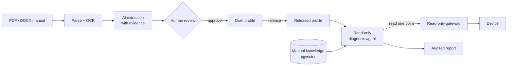

<div align="center">

# Device AI Agent

**Turn industrial device manuals into reviewable device profiles, and diagnose
devices with an AI agent that can only read.**

[](LICENSE)


English | [简体中文](README.zh-CN.md)

</div>

---

Integrating a new industrial device usually means someone reads a 300-page
manual, copies register maps into a spreadsheet, and hopes nothing was
mistyped. Diagnosing it later means more manual reading and more guesswork.

Device AI Agent automates the tedious parts without giving up control:

- **AI drafts, humans approve.** Upload a PDF or DOCX manual (scanned ones
  too). The system extracts a device profile candidate in which sourced fields
  link back to the exact page and passage. Nothing becomes a profile until a
  reviewer approves it, and AI output never releases a profile.
- **Diagnosis that cannot break anything.** The diagnosis agent reasons over
  released profiles and manual evidence, and may read one named point at a
  time through a read-only gateway. It has no write tools, no raw addresses,
  no SQL, and every step is audited.
- **One capability model across protocols.** Describe what a device *can do*
  once (observe, control, diagnose, configure) and bind it to Modbus, BACnet,
  MQTT, or OPC UA points per profile. Commands are generated from those
  bindings.

## How it works



## Features

| | |
| --- | --- |
| **Device catalog** | Categories, models, versioned profiles; released configuration is immutable |
| **Capability model** | Global, protocol-independent capabilities bound to device points by role |
| **Command generation** | Namespaced commands generated from capability templates |
| **Manual ingestion** | Quarantined upload, structure and risk checks, deterministic parsing, OCR for scanned pages |
| **Evidence-linked extraction** | Candidate fields cite source blocks and pages; schema and domain validation before review |
| **Review console** | Web UI to compare AI output with evidence, edit, approve, reject, and import, with a full audit trail |
| **Scoped RAG** | pgvector search always limited to a document or device model |
| **Read-only diagnosis** | Bounded tool-calling loop, step limit, per-run locking, evidence-backed reports |
| **Evaluation harness** | Versioned cases measuring accuracy, escalation rate, dangerous-action rate, cost, latency |
| **Bring your own models** | Any OpenAI-compatible endpoint, configured separately for extraction, vision, embeddings, and diagnosis |

## Quick start

Requirements: Docker with Compose v2.

```bash
git clone https://github.com/yinchi-34/device-ai-agent.git
cd device-ai-agent
cp .env.example .env        # set DEVICE_DATABASE_PASSWORD, DEVICE_ADMIN_PASSWORD, model settings

docker compose up --build -d
docker compose exec control-api alembic upgrade head
```

Open:

- API docs: <http://localhost:8000/docs>
- Review console: <http://localhost:8000/admin/documents>

Pages sign you in through the identity provider; the local Keycloak user is
`reviewer` / `reviewer`.

### Try it

Every `/api/v1` call needs a token from the identity provider. With the local
Keycloak, the example machine client gets one like this:

```bash
TOKEN=$(curl -s -d grant_type=client_credentials -d client_id=device-cli \
  -d client_secret=local-dev-cli-secret \
  http://localhost:8180/realms/device/protocol/openid-connect/token \
  | python3 -c 'import sys, json; print(json.load(sys.stdin)["access_token"])')
```

Upload a manual and start extraction:

```bash
curl -H "Authorization: Bearer $TOKEN" -F file=@manual.pdf -F device_model_id=1 http://localhost:8000/api/v1/documents
curl -H "Authorization: Bearer $TOKEN" -X POST http://localhost:8000/api/v1/documents/1/extraction-runs
```

Review and import the candidate in the console. After the profile is
released and a device instance exists, run a diagnosis:

```bash
curl -H "Authorization: Bearer $TOKEN" -X POST http://localhost:8000/api/v1/diagnosis-runs \
  -H 'Content-Type: application/json' \
  -d '{"device_id": 1, "symptom": "Supply air temperature keeps rising"}'
curl -H "Authorization: Bearer $TOKEN" -X POST http://localhost:8000/api/v1/diagnosis-runs/1/execute
```

## Documentation

- [Developer guide](DEVELOPMENT.md): architecture, project structure,
  configuration reference, API map, local development, testing
- Interactive API reference: `/docs` on a running instance

## Roadmap

- [x] Phase 1: device catalog, capability model, command generation
- [x] Phase 2: document intelligence and human review console
- [x] Phase 3: read-only diagnosis agent and evaluation harness
- [x] API authentication: OIDC identity provider, Caddy + oauth2-proxy gateway, JWT-verifying API
- [ ] Production hardening: CI, deployment guide

## Security

The review console and API are meant for trusted networks. By default, Docker
Compose binds ports to `127.0.0.1`. Do not expose the service directly to the
internet. See [deployment notes](DEVELOPMENT.md#deployment-notes).

## Contributing

Issues and pull requests are welcome. Please run `ruff check .` and
`pytest -v` from `services/control_api` before submitting; see the
[developer guide](DEVELOPMENT.md#testing) for test database setup.

## License

[MIT](LICENSE)
