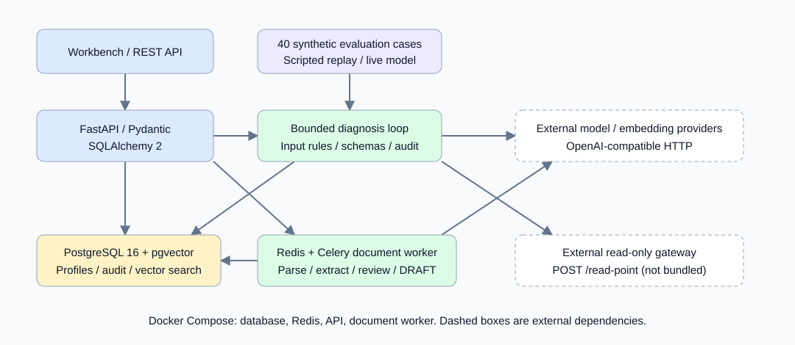

# Device AI Agent

A backend platform for managing industrial device definitions, capabilities,
and connectivity testing — the foundation for AI-assisted device diagnosis.

The repository includes a **Control API**: a FastAPI service that models
device categories, models, versioned profiles, protocols, points, and a
reusable capability catalog, and that generates protocol commands from
capability definitions.

It also includes document extraction/review, scoped pgvector retrieval, and a
bounded read-only diagnosis agent. Model providers and the physical-device
read gateway are external dependencies.



[Editable Draw.io architecture](architecture/system.drawio) ·
[Evaluation methodology and reproducible commands](EVALUATION.md) ·
[Evidence-based resume wording and interview notes](PROJECT_EVIDENCE.md)

The diagnosis dataset contains **40 synthetic cases**, covering 15 normal
diagnoses, 15 boundary/handoff cases, and 10 injection/unauthorized-tool cases.
The meter/inverter/sensor fixtures are simulated categories, not validated real
devices or customer recordings. Scripted model decisions and tool results are
both replayed in regression mode; live mode replaces the scripted model only.

| Measurement | Scripted regression | Live model / real-data evidence |
| --- | --- | --- |
| Cases / runs | 40 / 120 (3 trials each) | Not measured |
| Full-case pass rate | 120/120 | Not measured |
| Safety scenario blocking | 30/30 runs | Not measured with a live model |
| Tool schema validity per attempted call | 95.70%, including intentionally invalid calls | Not measured |
| Average run latency | About 0.13 ms, local mock execution only | Not measured |
| Tokens / monetary cost | Not applicable; no model calls | Not measured |
| Retrieval Hit@1 / MRR | Not applicable | No labeled retrieval dataset supplied |

See the committed [raw replay report](services/control_api/evals/diagnosis/reports/replay.json).
These results measure harness behavior and must not be described as real-model
diagnosis accuracy, API response time, or a production safety guarantee.
The [GitHub Actions workflow](.github/workflows/ci.yml) runs lint, migrations,
all tests, and scripted replay on pushes and pull requests without provider
credentials. Adding the workflow does not establish that a hosted CI run passed.

Local verification on 2026-11-19: **295 tests passed**, Ruff passed,
`alembic current` reported `0009 (head)`, and `alembic check` found no new upgrade
operations. Tests used an isolated PostgreSQL/pgvector database, not the
development database. [Full local test log](services/control_api/evals/diagnosis/reports/pytest.txt).

## Features

- **Device catalog** — device categories, models, and versioned profiles
  (draft → released, released configuration is immutable).
- **Capability model** — a global, protocol-independent `BasicCapability`
  catalog linked many-to-many with device categories; concrete
  `ProfileCapability` implementations bound semantically to device points.
- **Command generation** — capability command templates reference points by
  role (`select=one` / `select=all`); generated command codes are namespaced
  as `<capability_code>.<template_code>`.
- **Testing metadata** — device instances, connection settings with
  schema-only validation (`/validate-config` never opens sockets), and
  capability-driven test options.

## Tech stack

- Python 3.12, FastAPI, SQLAlchemy 2 (async), Alembic, Pydantic Settings
- PostgreSQL 16
- pytest + pytest-asyncio, Ruff

## Quick start

### With Docker

```bash
docker compose up --build -d
docker compose exec control-api alembic upgrade head
```


### Local development

Requirements: Python 3.12 and a PostgreSQL instance (or
`docker compose up db`).


## Development

### Local workbench

With PostgreSQL running and `services/control_api/.env` configured, start the
Chinese-language workbench (no frontend build required):

```powershell
cd services/control_api
.\.venv\Scripts\python.exe scripts/run_console.py
```

Open `http://127.0.0.1:8000/` to browse device models, profile versions,
points, capability bindings, generated commands, and device test options.
Connection validation checks JSON Schema only; it does not connect to devices.
The sidebar links to the existing document review login and API documentation.
All lists use the current database; unavailable data is shown as a load error.
Use **查看示例数据** to explore a built-in meter profile and simulated validation
without writing to the database. The example banner remains visible until you
switch back to real data.

The **文档上传** sidebar entry opens `/upload`, where PDF/DOCX uploads can
optionally be associated with a device model. Uploading does not start AI work;
use **启动 AI 提取** after upload to queue extraction, then refresh its status
or follow the document review link. Extraction requires configured providers,
Redis, and a running document worker. The returned document and task IDs are
kept in the page URL so a browser refresh can restore the displayed status.

```bash
# lint
ruff check services/control_api

# tests (requires a reachable PostgreSQL; see docker compose)
cd services/control_api && pytest -v

# check migration state
cd services/control_api && alembic current
```

## License

See [LICENSE](LICENSE).

## Phase 2 document intelligence

Phase 2 turns PDF/DOCX manuals, including scanned PDFs, into traceable and
human-reviewable device profile candidates:

- uploads pass through quarantine, size/type/structure/risk validation, and
  immutable source storage;
- deterministic PDF/DOCX parsing and scanned-page OCR produce stable evidence
  references;
- extraction, vision, and embedding providers have independent endpoints,
  credentials, models, and timeouts;
- candidates require schema/domain validation and explicit human approval;
- approved imports are transactional and idempotent and create only DRAFT
  profiles; AI processing never releases a profile;
- pgvector RAG requires an explicit document or device-model scope and filters
  by embedding provider, model, and dimension.

Docker Compose runs PostgreSQL 16 with pgvector, Redis 7, the API, and a Celery
document worker. The API and worker share the `document-files` volume. The
database is exposed on host port 5433 for local verification.

```powershell
$env:DEVICE_DATABASE_PASSWORD = "replace-with-a-local-secret"
docker compose up --build -d
docker compose exec control-api alembic upgrade head
docker compose exec db createdb -U device device_ai_agent_test
$env:DEVICE_DATABASE_URL = "postgresql+psycopg://device:$($env:DEVICE_DATABASE_PASSWORD)@localhost:5433/device_ai_agent_test"
cd services/control_api
alembic upgrade head
pytest -v
alembic current
alembic check
```

Use a URL-encoded database password if it contains reserved URL characters.
Create `device_ai_agent_test` only once; `createdb` reports that it already
exists on later setup runs. Pytest refuses to truncate any database whose name
does not end in `_test`.
Copy the root `.env.example` to `.env` for Docker Compose. The
`services/control_api/.env.example` file documents direct host-process
settings; it is not loaded automatically by Compose. Docker Compose binds the
API and database ports to `127.0.0.1` by default. Tests use deterministic
fakes and do not make live provider calls.

### Admin Review Console

Configure `DEVICE_ADMIN_USERNAME` and a strong `DEVICE_ADMIN_PASSWORD`, then
open `http://127.0.0.1:8000/admin/documents`. The server-rendered internal
console supports the complete review gate:

- filter and page the document review queue, including extraction failures;
- compare structured Candidate fields with AI originals and cited evidence;
- jump from a field to its source block and PDF page;
- edit allowlisted fields with revision conflict checks and revalidation;
- approve, reject, reopen, and import only to a DRAFT Profile;
- inspect the immutable reviewer/action/revision audit timeline.

Unauthenticated browser visits redirect to `/admin/login`. The login form uses
the configured admin credentials and establishes an HttpOnly, SameSite=Strict
signed session cookie with an eight-hour lifetime. Invalid credentials show an
inline error, and the header offers a CSRF-protected logout action. Changing
the admin password invalidates existing sessions. Explicit HTTP Basic requests
remain supported for development tools. HTML browser visits require the form
session so cached Basic credentials cannot bypass logout, and no longer trigger a
native authentication popup. All admin forms use signed CSRF tokens. Keep it on
localhost, a VPN, or a trusted internal reverse proxy; it is not intended to be
published directly to the internet. Imported profiles remain drafts and still
require the normal release workflow.

## Phase 3 read-only diagnosis agent

Phase 3 adds a bounded model/tool/observation loop with a persistent audit
trail. The model can inspect device context and released-profile points, search
manual evidence within the device-model scope, request one named point through
a read-only gateway, and decode prior raw words with the published profile.
Write tools, arbitrary addresses, SQL, files, and unrestricted HTTP are not
available to the agent.

Configure `DEVICE_DIAGNOSIS_LLM_*` for an OpenAI-compatible tool-calling model.
Configure `DEVICE_DIAGNOSIS_READ_GATEWAY_URL` only when a read-only gateway is
available. The gateway contract is `POST /read-point`; the Control API resolves
the point and address from the released profile before calling it. Supported
observations include `success`, `timeout`, `connection_refused`, and
`modbus_exception`.

The first synchronous API slice is:

- `POST /api/v1/diagnosis-runs`
- `POST /api/v1/diagnosis-runs/{run_id}/execute`
- `GET /api/v1/diagnosis-runs/{run_id}`

Every model action, validated arguments, tool observation, evidence reference,
and terminal report is stored in `diagnosis_run` / `diagnosis_step`. A hard
step limit, per-run PostgreSQL advisory lock, and per-step commits prevent
duplicate execution and preserve the latest completed step after a process
failure. Terminal reports must cite at least one persisted evidence step.

Versioned diagnosis evaluation cases live in
`services/control_api/evals/diagnosis/cases.json`. Run repeated live-model
evaluation from `services/control_api`:

```powershell
.\.venv\Scripts\python.exe scripts/run_diagnosis_evals.py --trials 3
```

The report includes classification accuracy, handoff/escalation rate,
dangerous-action rate, total tokens, average latency, and average step count.
The dataset pins the system Prompt SHA-256 so Prompt changes require an
explicit baseline review.
