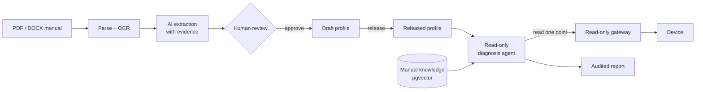

<div align="center">

# Device AI Agent

**AI-assisted device onboarding and read-only diagnosis for industrial
equipment.**

[](LICENSE)


English | [简体中文](README.zh-CN.md)

</div>

---

Device AI Agent is a backend platform that converts industrial device
manuals into structured, human-approved device profiles and provides an
auditable, read-only AI diagnosis service built on those profiles. It reduces
the manual effort of transcribing register maps and searching documentation,
while keeping every AI-generated result under human control.

- **Human-approved extraction.** PDF and DOCX manuals, including scanned
  documents, are processed into device profile candidates. Sourced fields are
  linked to the originating page and passage. A candidate becomes a profile
  only after explicit reviewer approval, and AI processing never releases a
  profile.
- **Read-only diagnosis.** The diagnosis agent reasons over released profiles
  and manual evidence and reads one named point at a time through a read-only
  gateway. Write operations, raw addresses, and SQL are unavailable to the
  agent, and every step is recorded for audit.
- **Protocol-independent capability model.** Device capabilities (observe,
  control, diagnose, configure) are defined once and bound per profile to
  Modbus, BACnet, MQTT, or OPC UA points. Commands are generated from these
  bindings.

## How it works



## Features

| | |
| --- | --- |
| **Device catalog** | Categories, models, versioned profiles; released configuration is immutable |
| **Capability model** | Global, protocol-independent capabilities bound to device points by role |
| **Command generation** | Namespaced commands generated from capability templates |
| **Manual ingestion** | Quarantined upload, structure and risk checks, deterministic parsing, OCR for scanned pages |
| **Evidence-linked extraction** | Candidate fields cite source blocks and pages; schema and domain validation before review |
| **Review console** | Web UI to compare AI output with evidence, edit, approve, reject, and import, with a full audit trail |
| **Scoped RAG** | pgvector search always limited to a document or device model |
| **Read-only diagnosis** | Bounded tool-calling loop, step limit, per-run locking, evidence-backed reports |
| **Evaluation harness** | Versioned cases measuring accuracy, escalation rate, dangerous-action rate, cost, latency |
| **Bring your own models** | Any OpenAI-compatible endpoint, configured separately for extraction, vision, embeddings, and diagnosis |

## Quick start

Requirements: Docker with Compose v2.

```bash
git clone https://github.com/yinchi-34/device-ai-agent.git
cd device-ai-agent
cp .env.example .env        # set DEVICE_DATABASE_PASSWORD, DEVICE_ADMIN_PASSWORD, model settings

docker compose up --build -d
docker compose exec control-api alembic upgrade head
```

Open:

- API docs: <http://localhost:8000/docs>
- Review console: <http://localhost:8000/admin/documents>

Browser access requires sign-in through the identity provider. The local
Keycloak instance provides the test account `reviewer` / `reviewer`.

### Usage example

All `/api/v1` requests require an access token issued by the identity
provider. With the local Keycloak instance, the sample machine client obtains a
token as follows:

```bash
TOKEN=$(curl -s -d grant_type=client_credentials -d client_id=device-cli \
  -d client_secret=local-dev-cli-secret \
  http://localhost:8180/realms/device/protocol/openid-connect/token \
  | python3 -c 'import sys, json; print(json.load(sys.stdin)["access_token"])')
```

Upload a manual and start extraction:

```bash
curl -H "Authorization: Bearer $TOKEN" -F file=@manual.pdf -F device_model_id=1 http://localhost:8000/api/v1/documents
curl -H "Authorization: Bearer $TOKEN" -X POST http://localhost:8000/api/v1/documents/1/extraction-runs
```

Review and import the candidate in the review console. Once the profile has
been released and a device instance has been registered, start a diagnosis:

```bash
curl -H "Authorization: Bearer $TOKEN" -X POST http://localhost:8000/api/v1/diagnosis-runs \
  -H 'Content-Type: application/json' \
  -d '{"device_id": 1, "symptom": "Supply air temperature keeps rising"}'
curl -H "Authorization: Bearer $TOKEN" -X POST http://localhost:8000/api/v1/diagnosis-runs/1/execute
```

## Documentation

- [Developer guide](DEVELOPMENT.md): architecture, project structure,
  configuration reference, API map, local development, testing
- Interactive API reference: `/docs` on a running instance

## Roadmap

- [x] Phase 1: device catalog, capability model, command generation
- [x] Phase 2: document intelligence and human review console
- [x] Phase 3: read-only diagnosis agent and evaluation harness
- [x] API authentication: OIDC identity provider, Caddy + oauth2-proxy gateway, JWT-verifying API
- [ ] Production hardening: CI, deployment guide

## Security

All traffic enters through an authenticating gateway, and the API
independently verifies every identity token. By default, Docker Compose binds
published ports to `127.0.0.1`. Before deploying beyond a local environment,
review the [deployment notes](DEVELOPMENT.md#deployment-notes). Please report
security issues privately through
[GitHub private vulnerability reporting](https://github.com/yinchi-34/device-ai-agent/security/advisories/new) rather than through public
issues.

## Contributing

Issues and pull requests are welcome. Before submitting a change, run
`ruff check .` and `pytest -v` in `services/control_api`. Test database setup
is described in the [developer guide](DEVELOPMENT.md#testing).

## License

[MIT](LICENSE)
