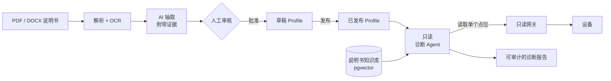

<div align="center">

# Device AI Agent

**面向工业设备的 AI 辅助接入与只读诊断平台。**

[](LICENSE)


[English](README.md) | 简体中文

</div>

---

Device AI Agent 是一个后端平台，可将工业设备说明书转换为经人工审核的结构化设备
Profile，并基于这些 Profile 提供可审计的只读 AI 诊断服务。平台减少了人工录入寄存器表、
查阅说明书的工作量，同时确保所有 AI 生成的结果始终处于人工管控之下。

- **人工审核的智能抽取**：支持 PDF 与 DOCX 说明书（含扫描件），自动生成设备 Profile
  候选，有来源的字段均可追溯至原文页码与段落。候选须经审核人员明确批准方可成为
  Profile，AI 处理流程不会发布 Profile。
- **只读诊断**：诊断 Agent 基于已发布的 Profile 与说明书证据进行推理，每次仅可通过
  只读网关读取一个指定点位。Agent 无法执行写操作、访问原始地址或执行 SQL，所有步骤
  均留存审计记录。
- **协议无关的能力模型**：设备能力（观测、控制、诊断、配置）只需定义一次，即可在各
  Profile 中绑定至 Modbus、BACnet、MQTT 或 OPC UA 点位，并据此自动生成命令。

## 工作原理



## 功能

| | |
| --- | --- |
| **设备目录** | 类别、型号、版本化 Profile；发布后的配置不可修改 |
| **能力模型** | 全局、与协议无关的能力，按角色绑定到设备点位 |
| **命令生成** | 由能力模板生成带命名空间的命令 |
| **说明书导入** | 隔离上传、结构与风险校验、确定性解析、扫描页 OCR |
| **带证据的抽取** | 候选字段引用源文本块和页码；进入审核前先做 Schema 和领域校验 |
| **审核台** | Web 界面对照 AI 输出与原文证据，可编辑、批准、驳回、导入，全程留痕 |
| **限定范围的 RAG** | pgvector 检索始终限定在某个文档或设备型号内 |
| **只读诊断** | 有边界的工具调用循环、步数上限、任务级加锁、基于证据的报告 |
| **评测工具** | 版本化用例，衡量准确率、升级率、危险操作率、成本和延迟 |
| **自选模型** | 任何 OpenAI 兼容接口，抽取、视觉、Embedding、诊断可分别配置 |

## 快速开始

环境要求：Docker 及 Compose v2。

```bash
git clone https://github.com/yinchi-34/device-ai-agent.git
cd device-ai-agent
cp .env.example .env        # 设置 DEVICE_DATABASE_PASSWORD、DEVICE_ADMIN_PASSWORD 和模型配置

docker compose up --build -d
docker compose exec control-api alembic upgrade head
```

打开：

- API 文档：<http://localhost:8000/docs>
- 审核台：<http://localhost:8000/admin/documents>

通过浏览器访问时需经身份提供方登录。本地 Keycloak 提供测试账号 `reviewer` / `reviewer`。

### 使用示例

所有 `/api/v1` 请求均需携带身份提供方签发的访问令牌。使用本地 Keycloak 时，可通过
示例程序客户端获取令牌：

```bash
TOKEN=$(curl -s -d grant_type=client_credentials -d client_id=device-cli \
  -d client_secret=local-dev-cli-secret \
  http://localhost:8180/realms/device/protocol/openid-connect/token \
  | python3 -c 'import sys, json; print(json.load(sys.stdin)["access_token"])')
```

上传说明书并启动抽取：

```bash
curl -H "Authorization: Bearer $TOKEN" -F file=@manual.pdf -F device_model_id=1 http://localhost:8000/api/v1/documents
curl -H "Authorization: Bearer $TOKEN" -X POST http://localhost:8000/api/v1/documents/1/extraction-runs
```

在审核台中完成候选的审核与导入。Profile 发布且设备实例注册完成后，即可发起诊断：

```bash
curl -H "Authorization: Bearer $TOKEN" -X POST http://localhost:8000/api/v1/diagnosis-runs \
  -H 'Content-Type: application/json' \
  -d '{"device_id": 1, "symptom": "送风温度持续升高"}'
curl -H "Authorization: Bearer $TOKEN" -X POST http://localhost:8000/api/v1/diagnosis-runs/1/execute
```

## 文档

- [开发文档](DEVELOPMENT.zh-CN.md)：架构、项目结构、配置说明、API 一览、本地开发、测试
- 交互式 API 文档：运行中实例的 `/docs`

## 路线图

- [x] 阶段 1：设备目录、能力模型、命令生成
- [x] 阶段 2：文档智能与人工审核台
- [x] 阶段 3：只读诊断 Agent 与评测工具
- [x] API 认证：OIDC 身份提供方、Caddy + oauth2-proxy 网关、应用校验 JWT
- [ ] 生产化：CI、部署指南

## 安全

所有流量均经由带认证的网关进入，API 会对每个身份令牌进行独立校验。Docker Compose
默认仅将对外端口绑定至 `127.0.0.1`。在本地以外的环境部署前，请参阅
[部署注意事项](DEVELOPMENT.zh-CN.md#部署注意事项)。如发现安全问题，请通过
[GitHub 私密漏洞报告](https://github.com/yinchi-34/device-ai-agent/security/advisories/new)提交，请勿通过公开 Issue 提交。

## 参与贡献

欢迎提交 Issue 与 Pull Request。提交变更前，请在 `services/control_api` 目录下运行
`ruff check .` 与 `pytest -v`。测试数据库的准备方法请参阅[开发文档](DEVELOPMENT.zh-CN.md#测试)。

## 许可证

[MIT](LICENSE)
