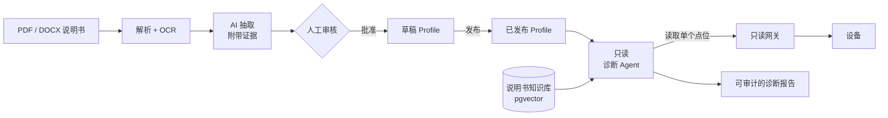

<div align="center">

# Device AI Agent

**把工业设备说明书变成可审核的设备 Profile，再用一个只能“读”的 AI Agent 诊断设备。**

[](LICENSE)


[English](README.md) | 简体中文

</div>

---

接入一台新的工业设备，往往要有人啃完几百页说明书，把寄存器表抄进表格，再祈祷
没有抄错。设备出了问题，又得回头翻说明书、凭经验排查。

Device AI Agent 把繁琐的部分自动化，同时不放弃人的控制权：

- **AI 起草，人来把关。** 上传 PDF 或 DOCX 说明书（扫描版也可以），系统抽取出
  设备 Profile 候选，有来源的字段都能追溯到原文的具体页码和段落。候选必须经过
  人工批准才会成为 Profile，AI 也永远不会发布 Profile。
- **诊断过程不会弄坏任何东西。** 诊断 Agent 基于已发布的 Profile 和说明书证据
  推理，每次只能通过只读网关读取一个指定点位。它没有写操作、不能用原始地址、
  不能执行 SQL，每一步都有审计记录。
- **一套能力模型，跨所有协议。** 只需描述一次设备“能做什么”（观测、控制、诊断、
  配置），再在各个 Profile 中绑定到 Modbus、BACnet、MQTT 或 OPC UA 点位。
  命令根据这些绑定自动生成。

## 工作原理



## 功能

| | |
| --- | --- |
| **设备目录** | 类别、型号、版本化 Profile；发布后的配置不可修改 |
| **能力模型** | 全局、与协议无关的能力，按角色绑定到设备点位 |
| **命令生成** | 由能力模板生成带命名空间的命令 |
| **说明书导入** | 隔离上传、结构与风险校验、确定性解析、扫描页 OCR |
| **带证据的抽取** | 候选字段引用源文本块和页码；进入审核前先做 Schema 和领域校验 |
| **审核台** | Web 界面对照 AI 输出与原文证据，可编辑、批准、驳回、导入，全程留痕 |
| **限定范围的 RAG** | pgvector 检索始终限定在某个文档或设备型号内 |
| **只读诊断** | 有边界的工具调用循环、步数上限、任务级加锁、基于证据的报告 |
| **评测工具** | 版本化用例，衡量准确率、升级率、危险操作率、成本和延迟 |
| **自选模型** | 任何 OpenAI 兼容接口，抽取、视觉、Embedding、诊断可分别配置 |

## 快速开始

环境要求：Docker 及 Compose v2。

```bash
git clone https://github.com/yinchi-34/device-ai-agent.git
cd device-ai-agent
cp .env.example .env        # 设置 DEVICE_DATABASE_PASSWORD、DEVICE_ADMIN_PASSWORD 和模型配置

docker compose up --build -d
docker compose exec control-api alembic upgrade head
```

打开：

- API 文档：<http://127.0.0.1:8000/docs>
- 审核台：<http://127.0.0.1:8000/admin/documents>

### 试一试

上传一份说明书并开始抽取：

```bash
curl -F file=@manual.pdf -F device_model_id=1 http://127.0.0.1:8000/api/v1/documents
curl -X POST http://127.0.0.1:8000/api/v1/documents/1/extraction-runs
```

在审核台中审核并导入候选。Profile 发布、设备实例创建好之后，发起一次诊断：

```bash
curl -X POST http://127.0.0.1:8000/api/v1/diagnosis-runs \
  -H 'Content-Type: application/json' \
  -d '{"device_id": 1, "symptom": "送风温度持续升高"}'
curl -X POST http://127.0.0.1:8000/api/v1/diagnosis-runs/1/execute
```

## 文档

- [开发文档](DEVELOPMENT.zh-CN.md)：架构、项目结构、配置说明、API 一览、本地开发、测试
- 交互式 API 文档：运行中实例的 `/docs`

## 路线图

- [x] 阶段 1：设备目录、能力模型、命令生成
- [x] 阶段 2：文档智能与人工审核台
- [x] 阶段 3：只读诊断 Agent 与评测工具
- [ ] 生产化：API 认证、CI、部署指南

## 安全

审核台和 API 面向可信网络使用。Docker Compose 默认只把端口绑定到
`127.0.0.1`。请不要把服务直接暴露到公网，详见[部署注意事项](DEVELOPMENT.zh-CN.md#部署注意事项)。

## 参与贡献

欢迎提交 Issue 和 Pull Request。提交前请在 `services/control_api` 目录下运行
`ruff check .` 和 `pytest -v`；测试数据库的准备方法见[开发文档](DEVELOPMENT.zh-CN.md#测试)。

## 许可证

[MIT](LICENSE)
